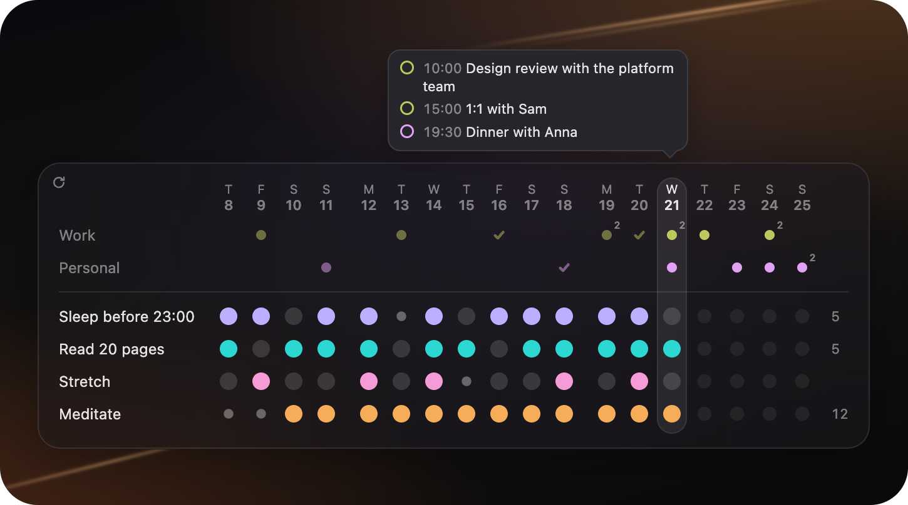

# Dailies

A minimalist habit tracker for [Übersicht](https://tracesof.net/uebersicht/).



One row per habit, one column per day, a dot in every cell. Click a dot to cycle **empty → done → skipped → empty**. The card sits in a chosen corner of your screen, sizes itself to your habits and the number of days you show, and follows light and dark mode.

- **Your calendars alongside:** subscribe to any iCloud (or other) calendar link and see upcoming events above your habits, with the title one hover away.
- **Low maintenance:** one small JSON config, no dependencies or build step.
- **Your data stays plain text:** every tap is one line in a log file you can read, back up or sync.
- **Colors take care of themselves:** each habit gets its own, and they always look good together.

## Install

You need macOS and [Übersicht](https://tracesof.net/uebersicht/).

```bash
git clone https://github.com/paraversal/uebersichtdailies.git
cd uebersichtdailies
cp dailies.widget/config.example.json dailies.widget/config.json
ln -s "$PWD/dailies.widget" "$HOME/Library/Application Support/Übersicht/widgets/dailies.widget"
```

Then refresh the widgets from the Übersicht menu bar icon. Edit your habits in `dailies.widget/config.json`; Übersicht reloads the widget whenever the file changes.

> **Link `dailies.widget/`, not the whole repo.** Übersicht treats every `.js` and `.jsx` file under its widgets folder as a widget, so linking the repo root makes it try to load the test files and show a parse error. The name of the link doesn't matter.

## Using it

| Action | Result |
|---|---|
| Click an empty dot | marks the day **done**, with a small pop animation |
| Click it again | marks it **skipped** (a rest day: it doesn't break a streak) |
| Click once more | back to **empty** |

Today is the rightmost column, unless you set `n_future` to also show upcoming days (see Calendars). A number at the end of a row shows your current streak of consecutive done days once it reaches 2. You can fill in or fix any day that is visible, so a missed tap is easy to correct.

## Config

`dailies.widget/config.json`:

```json
{
    "n_col": 14,
    "n_future": 7,
    "show_success_animation": true,
    "location": "bottom_left",
    "margin": 20,
    "day_starts_at": "00:00",
    "week_starts": "monday",
    "habits": [
        "go to sleep on time",
        { "id": "read", "name": "read 20 pages", "color": "#7aa2f7" }
    ],
    "calendars": [
        { "name": "Work", "url": "webcal://p01-caldav.icloud.com/published/2/..." }
    ]
}
```

| Key | Default | Meaning |
|---|---|---|
| `n_col` | `14` | Days shown up to and including today, 1–60. Older data is kept, just not displayed. |
| `n_future` | `0` | Extra days shown after today, 0–30. They show calendar events; habit dots there are greyed out and can't be tapped. |
| `show_success_animation` | `true` | Pop and ring when a dot becomes done. Also turned off by the system "reduce motion" setting. |
| `location` | `"bottom_left"` | `top_left`, `top_right`, `bottom_left` or `bottom_right`. |
| `margin` | `20` | Distance from the screen edge, in px. |
| `day_starts_at` | `"00:00"` | When a new day begins. `"04:00"` makes 02:30 still count as the previous day. |
| `week_starts` | `"monday"` | `monday` or `sunday`. Sets the header letters and where the small gap between weeks goes. |
| `habits` | required | A list of strings, or objects with `name` plus optional `id` and `color`. |
| `calendars` | `[]` | Calendar subscription links, see Calendars. |
| `show_event_count` | `true` | A tiny number on a calendar dot when that day has 2 or more events. |
| `calendar_refresh_minutes` | `30` | How often feeds are downloaded again, 5–1440. |

Everything except `habits` is optional. Mistakes (a bad value, a duplicate habit, invalid JSON) are shown on the card itself rather than as a blank widget. Until `config.json` exists, the widget uses `config.example.json`. Your `config.json` is gitignored, so pulling updates never overwrites it.

### Habit ids and renaming

A habit's history is stored under its `id`. By default that is the name, lowercased and hyphenated (`"Go to sleep"` becomes `go-to-sleep`). So:

- **Renaming a habit starts it fresh.** That's usually what you want when the habit really changed.
- **To keep the history after a rename,** set `"id"` explicitly to the old value, e.g. `{ "id": "go-to-sleep", "name": "bedtime by 11" }`.
- An `id` may only contain `a-z`, `0-9`, `-` and `_`. Names with no latin letters (for example, Japanese) need an explicit `id`.

### Colors

Leave `color` out and each habit gets its own color automatically. The hue comes from the habit's `id`, so it never changes between reloads. Lightness and chroma are shared by all habits (in OKLCH), which is why any set of habits looks like one palette. Hues that land too close together are nudged apart, up to about eight habits clearly distinct.

To override a single habit, give it any CSS color: `"color": "#7aa2f7"`.

## Calendars

Add calendars as subscription links. Each one becomes a row between the dates and your habits, separated from the habit dots by a thin line:

```
 M  T  W  T  F  S  S      weekday letters
19 20 21 22 23 24 25      dates
 Work     ·  ·     ·      one small dot per day with events
 Home        ·           
──────────────────────
 sleep    ●  ●  ●  ●      your habits, as before
```

**Getting the link from Apple Calendar:** in Calendar, right-click a calendar → *Share Calendar…* → tick *Public Calendar* → *Copy Link*. It looks like `webcal://p01-caldav.icloud.com/published/2/…`. Paste it into `config.json`:

```json
"calendars": [
    { "name": "Work", "url": "webcal://p01-caldav.icloud.com/published/2/..." },
    { "name": "Home", "url": "webcal://…", "color": "#f2a65a" },
    "webcal://…"
]
```

A calendar can also be just the link; its own title is then used as the row label. `https://` links work as well, so Google, Fastmail and any other `.ics` feed are fine.

> **Treat the link like a password.** Anyone who has an iCloud public-calendar link can read that calendar. Keep it in `config.json` (which git ignores), and untick *Public Calendar* in Apple Calendar to revoke it. The widget only ever contacts that one address, and error messages never print it.

**Reading the grid**

- A dot means the calendar has at least one event that day. It is smaller than a habit dot so the two never get confused, and dimmer for days that have passed.
- **Hover** a dot to see that day's events: the title, with the start time in front when it has one. A small number on the dot shows the count when there are several (switch it off with `show_event_count`).
- **Today's events** are always shown in a small speech bubble above the card (below it for `top_*` locations), pointing at today's column. It steps aside while you hover another dot.
- Set `n_future` to see what is coming up, for example `7` for the next week.
- Colors work like habit colors: automatic and harmonious, or an explicit `"color"`.

**Fetching and caching.** Feeds are downloaded with `curl` in the background and cached in `~/Library/Application Support/Dailies/cache/`, by default every 30 minutes. A failed download keeps the last good copy, is retried at most every 5 minutes, and shows a short note on the card. Your events never leave your machine except through the link you subscribed to.

**What is understood.** Timed and all-day events, multi-day events, time zones, and recurring events: daily, weekly (`BYDAY`, `INTERVAL`), monthly (day of month, or e.g. "second Tuesday", "last Friday"), yearly (birthdays), with `COUNT`, `UNTIL`, excluded dates and moved single occurrences. Cancelled events are skipped. Not supported: `BYSETPOS`, sub-daily repeats, and Windows time zone names (those are read as your local time). The calendar is read-only; nothing is ever written back.

## Where your data lives

Every tap is appended as one JSON line to:

```
~/Library/Application Support/Dailies/log-<hostname>.jsonl
```

```json
{"t":1761350000000,"h":"go-to-sleep-on-time","d":"2026-10-25","v":1}
```

`t` is a timestamp in milliseconds, `h` the habit id, `d` the day, and `v` the state (`0` empty, `1` done, `2` skipped). The widget replays the log on load, and the latest event for each habit and day wins. It re-reads the log every 5 seconds, so several screens stay in sync, and a tap appears instantly before the write finishes.

Why it is built this way:

- **Outside the widget folder:** Übersicht reloads a widget when any file in its widgets folder changes, so writing data there would reload the widget on every tap.
- **Append-only:** a tap is a single short write, never a read-and-rewrite, so a double click or a second screen can't corrupt anything. A damaged line is skipped, not fatal.
- **One file per Mac:** machines never write the same file, so syncing the folder can't produce conflicts.

Downloaded calendar feeds live next to it in `Dailies/cache/` (`cal-<id>.ics`). They are a disposable cache: delete the folder and they are fetched again.

### Backup, sync and reset

- **Back up:** copy the `Dailies` folder (the `cache` part is optional).
- **Sync between Macs:** make `~/Library/Application Support/Dailies` a symlink to a folder in iCloud Drive or Dropbox on each Mac. Each machine's log is merged automatically. Without a synced folder, nothing leaves your Mac.
- **Start over:** delete the `log-*.jsonl` files. Your config is not affected.
- **Edit by hand:** the files are plain text, so you can fix or import history in any editor. Keep one JSON object per line.

## Troubleshooting

| Symptom | Likely cause |
|---|---|
| A parse error mentioning `test/core.test.js` | You linked the whole repo. Link `dailies.widget/` instead (see Install). |
| `dailies-read.sh not found` on the card | The widget folder isn't inside Übersicht's widgets folder, or the link is broken. |
| A red message on the card | A config problem. The message says which key to fix. |
| A habit lost its history | Its `id` changed, usually through a rename. Set `id` back (see above). |
| A calendar row stays empty | Check the card for a red `calendar "…"` message. If there is none, the feed may simply have no events in the visible days. Try opening the link in a browser: it should download an `.ics` file. |
| `calendar "…": … 404` or `403` | The link was revoked or mistyped. Copy it again from Apple Calendar. |
| Events at the wrong time | The feed uses a time zone name that isn't an IANA name (such as a Windows one). Such times are read as your local time. |
| Taps do nothing | Check Übersicht's interaction setting, then refresh widgets from the menu bar icon. |

## Development

The only requirement is Node, and only for the tests:

```bash
npm test      # or: node --test test/*.test.js
```

```
dailies.widget/
  index.jsx              rendering only: grid, taps, tooltips, styles
  lib/core.js            pure logic: config validation, days, log replay, streaks, colors
  lib/ics.js             pure logic: iCalendar parsing and recurrence expansion
  lib/calendar-sync.js   background loop that keeps the calendar cache fresh
  bin/dailies-log.sh     appends one tap event to the log
  bin/dailies-read.sh    prints the config and all logs
  bin/dailies-fetch.sh   downloads one calendar feed into the cache
  bin/dailies-calendars.sh  prints the cached feeds
  config.example.json
test/                    core, ics and fetch tests
```

The scripts are the only code that touches the disk, and `core.js` has no DOM or Übersicht dependencies, which is what makes it testable. All scripts honour a `DAILIES_DATA_DIR` environment variable, which the tests use to avoid touching your real data.

## License

GPL-3.0. See [LICENSE](LICENSE).
